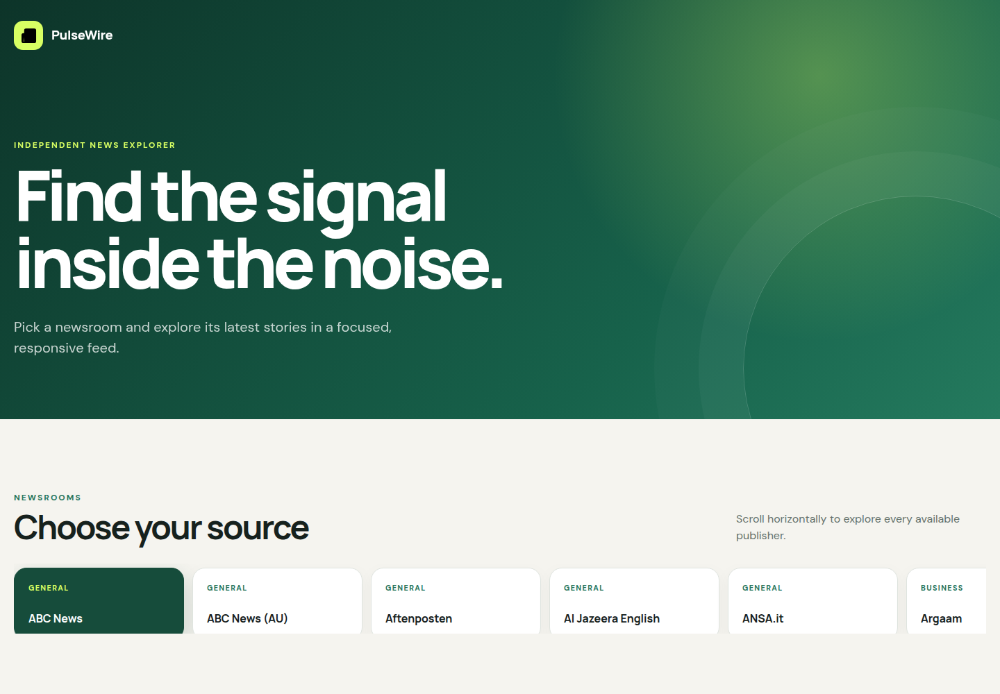

# PulseWire — News API

A responsive news explorer migrated from JavaScript to strict TypeScript. The application uses the News API proxy and its mock endpoints, so the deployed version works without exposing an API key.

## Deploy

https://yessethumanman.github.io/news-JS/



## Features

-   browse 120+ news sources in a horizontally scrollable source selector;
-   display the latest articles in a responsive 1/2/3-column grid;
-   show loading, empty and request error states;
-   safely handle nullable fields returned by News API;
-   open original articles in a new tab;
-   support keyboard focus and accessible pressed states;
-   adapt from 320px to 1920px without horizontal page overflow.

## TypeScript implementation

The application is fully migrated to `.ts` files and uses strict typing without `any`:

-   **Enums:** API endpoints and HTTP methods;
-   **Interfaces and object types:** API responses, sources and articles;
-   **Generics:** typed loader responses and generic DOM queries;
-   **Union types:** API statuses, query values and UI states;
-   **Classes and access modifiers:** `public`, `private` and `protected` members in the API and UI layers;
-   **Function types:** generic success callbacks and error callbacks;
-   **Utility types:** `Partial`, `Pick` and `Readonly` for query options, card data and API configuration.

TypeScript is configured with `strict` and `noImplicitAny`. ESLint uses `@typescript-eslint/recommended` and treats explicit `any` as an error.

## Design improvements

The original interface was redesigned as an editorial dashboard:

-   branded hero section and visual identity;
-   accessible source buttons with selected state;
-   responsive article card grid;
-   image placeholders for articles without media;
-   mobile-first spacing and typography;
-   reduced-motion support;
-   footer with the author profile, creation year and RS School course link.

## API configuration

By default, the application uses static proxy mocks:

```text
https://rss-news-api.onrender.com/mocks/sources
https://rss-news-api.onrender.com/mocks/everything
```

To use live News API responses, copy `.env.example` to `.env` and configure:

```env
API_URL=https://rss-news-api.onrender.com/
API_KEY=your_api_key
USE_MOCKS=false
```

Never commit the `.env` file.

## Local development

```bash
npm install
npm start
```

## Validation

```bash
npm run typecheck
npm run lint
npm run format:check
npm run build
```

Run every check with:

```bash
npm run validate
```

## Deployment

The production build is published to the `gh-pages` branch:

```bash
npm run deploy
```

## Project structure

```text
src/
├── assets/
├── components/
│   ├── app/
│   ├── controller/
│   └── view/
├── types/
├── utils/
├── global.css
├── index.html
└── index.ts
```
